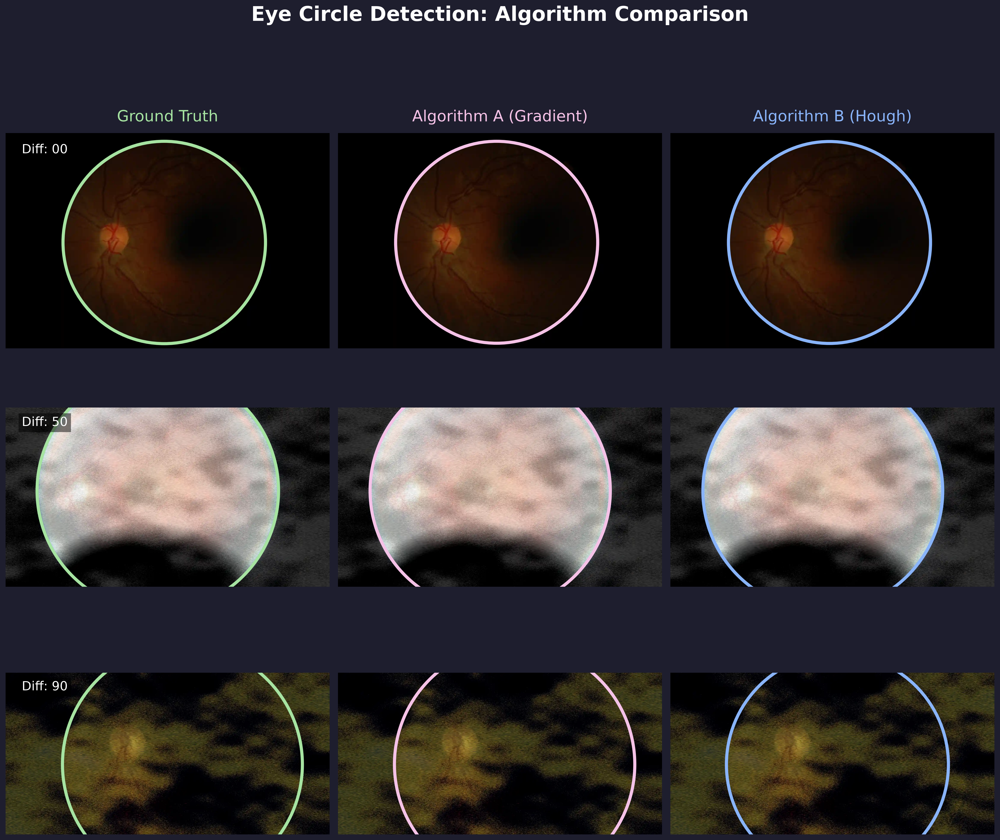

# Eye Circle Detection


A comprehensive computer vision project focused on detecting the center and radius of pupils/irises in images. 
This project documents the journey from classic computer vision baselines to a highly optimized custom algorithm, and finally, a deep learning approach.

## Overview

The goal of this project is to accurately locate a circle (representing an eye's pupil/iris) by outputting its coordinates `(cx, cy)` and radius `r`. 
Throughout the development, multiple pipelines were implemented, compared, and optimized:

1. **Hough Transform (Final Algorithm B)**: A highly optimized approach using `cv2.HoughCircles` combined with extreme median blurring and carefully tuned parameters. This acts as our most robust and fastest classical pipeline.
2. **Gradient-Based Voting (Optimized CV)**: A custom algorithm that calculates image gradients (using Scharr filters) and scores circle candidates based on the alignment of gradient vectors along their perimeter. This approach was heavily optimized using `Numba` and run through ~28 iterations of hyperparameters to achieve maximum Intersection over Union (IoU) with the ground truth.
3. **Deep Learning (EfficientNet)**: To make the inference faster and potentially more robust, an `EfficientNet-B0` model was trained using pseudo-labels generated by our best-performing custom gradient algorithm. The network treats the problem as a regression task, directly predicting normalized `(cy, cx, r)`.
4. **Experimental Approaches**: Documented in `src/algorithms/experiments.py`, this acts as an archive of various attempts including Geometric RANSAC, Algebraic Least Squares fitting, and Binary Masking with `HOUGH_GRADIENT_ALT`.

### Visualizing the Algorithms


## Performance Metrics

Our rigid parameter tuning and robust algorithms yield phenomenal performance on the validation dataset (based on Intersection over Union `IoU >= 0.85` representing a successful detection):

*   **Algorithm A (Gradient Voting):** ~**96% Success Rate**
*   **Algorithm B (Optimized Hough):** ~**98% Success Rate**

These metrics prove the extreme resilience of the algorithms against low lighting, fundus pathologies, and heavy noise.

## Project Structure

```text
projekt_oczy/
│
├── data/                       # Directory for the dataset (needs to be downloaded)
├── notebooks/
│   ├── archive/                # Archived experimental notebooks
│   ├── demo.ipynb              # Jupyter notebook with interactive visualizations
│   └── experiments_history.ipynb # Lab journal documenting the algorithm's parameter tuning
├── scripts/
│   ├── train_nn.py             # Script to train the EfficientNet model
│   └── generate_visuals.py     # Script to generate beautiful GitHub-ready graphics
├── src/
│   ├── algorithms/             # Detection algorithms
│   │   ├── gradient.py         # Custom Numba-optimized gradient voting algorithm
│   │   ├── fast_gradient.py    # Extremely fast variant of the gradient algorithm
│   │   ├── gradient_experiments.py # Historical iterations of the gradient algorithm
│   │   ├── experiments.py      # Archive of alternative methods (RANSAC, Least Squares)
│   │   ├── hough.py            # Final optimized Algorithm B
│   │   └── neural_network.py   # Deep learning EfficientNet inference
│   ├── data.py                 # PyTorch Datasets and JSON loading logic
│   ├── evaluation.py           # Metrics calculation (IoU) and runners
│   └── visualization.py        # Matplotlib/PIL drawing and plotting functions
│
├── app.py                      # Beautiful Streamlit interactive web application
├── requirements.txt            # Project dependencies
└── README.md
```

## Getting Started

### Prerequisites

Ensure you have Python 3.10+ installed. Install the dependencies using `pip`:

```bash
pip install -r requirements.txt
```

### Dataset
The dataset is essential to run the algorithms or the interactive demo. It must be placed in the `data/circle/` directory.

**To download the dataset automatically, run the following commands in the root of the project:**

**Windows (PowerShell):**
```powershell
New-Item -ItemType Directory -Force -Path data
Invoke-WebRequest -Uri "https://www.mimuw.edu.pl/~mw290715/upload/circle.tar.gz" -OutFile "data/circle.tar.gz"
cd data
tar -xf circle.tar.gz
```

**Linux/Mac (Bash):**
```bash
mkdir -p data/
wget -q 'https://www.mimuw.edu.pl/~mw290715/upload/circle.tar.gz' -O data/circle.tar.gz
cd data/
tar -xf circle.tar.gz
```

Alternatively, you can manually download the archive from [this link](https://www.mimuw.edu.pl/~mw290715/upload/circle.tar.gz) and extract its contents inside the `data/` folder.

### Interactive Demo
To see the algorithms in action, run the Jupyter Notebook:

```bash
jupyter notebook notebooks/demo.ipynb
```
Inside the notebook, you can interactively explore how each algorithm performs on the validation set using a slider widget.

### Training the Neural Network
To train the EfficientNet model using the generated pseudo-ground-truths from the gradient algorithm:

```bash
python -m scripts.train_nn --epochs 30 --batch_size 16
```
This will train the model, validate it against the validation set, plot the learning curves, and save the weights to `efficientnet_eyes.pth`.

## Methodology Highlights

* **CLAHE & Filtering**: Histogram equalization (CLAHE) combined with Gaussian/Median blurring proved essential for mitigating the natural, noisy structure of the human eye.
* **Numba FastMath**: The custom scoring function in `gradient.py` is compiled with `@numba.njit` to allow rapid evaluation of thousands of circle candidates in milliseconds.
* **Two-Phase Search**: The best gradient algorithm uses a two-phase search: a coarse search with large steps (`big_step = 6`), followed by a refined, pixel-perfect search around the best candidate.
* **Knowledge Distillation (Implicit)**: Training the neural network on the outputs of the CV algorithm effectively distills the complex, slow geometric logic into a fast, fixed-time forward pass.
